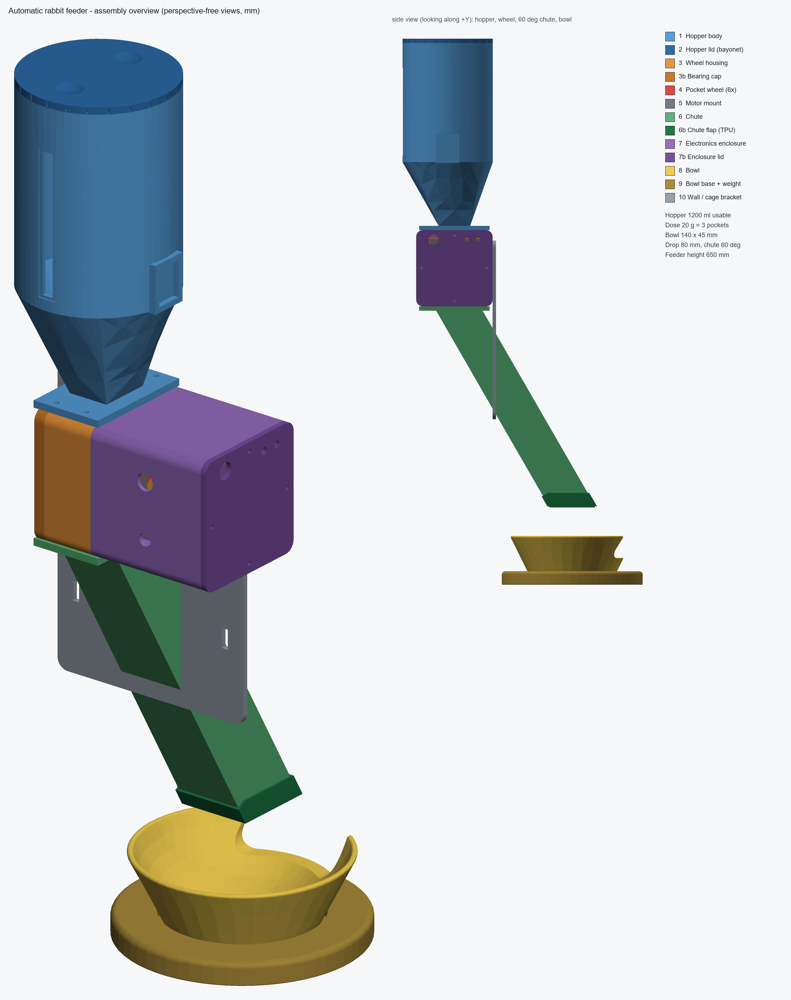

# Automatic rabbit feeder

Parametric, 3D-printable pellet feeder: 2 doses per day (07:00 / 19:00), ~20 g each (10-40 g adjustable),
refillable from the top, drops pellets through a 60 deg chute into a rabbit-sized bowl.
Built with [CadQuery](https://github.com/CadQuery/cadquery); every dimension is a named variable at the top of
[feeder.py](feeder.py).

## How it works

Pellets sit in the hopper and slide down the sloped funnel into a wheel with 6 pockets. Twice a day (07:00 and 19:00) the ESP32 reads the
clock, finds the wheel's home position with a magnet and a reed switch, and turns the stepper motor one pocket (60 deg) at a time. Each pocket
holds about 6.8 g and tips its pellets out at the bottom into the chute, so a 20 g dose is 3 pockets. The pellets slide down the chute and drop into the
bowl inside the pen. The motor and electronics stay outside the pen, and you refill the hopper through the lid on top.

| File | What |
|------|------|
| [feeder.py](feeder.py) | parametric source (all parameters at the top, one builder per part) |
| [build.py](build.py) | exports STL + STEP, runs the design checks, renders the image |
| `stl/` | one STL per part, **already in print orientation** |
| `baya feeder.FCStd` | the FreeCAD document: all 13 parts inside the Assembly (assembly pose, no joints yet); refresh with `freecadcmd to_freecad.py` after `python build.py` |
| `step/` | the same parts in assembly pose + `rabbit_feeder_assembly.step` (opens in FreeCAD) |
| [docs/checks.md](docs/checks.md) | generated verification report |
| [BOM.md](BOM.md) | bill of materials |
| [firmware/rabbit_feeder/rabbit_feeder.ino](firmware/rabbit_feeder/rabbit_feeder.ino) | ESP32 sketch |

Rebuild after changing any parameter: `pip install cadquery pillow numpy trimesh` then `python build.py`
(about 20 s). `python build.py --no-render` skips the image.

## Key numbers (from `docs/checks.md`)

| | |
|---|---|
| Pocket volume | 10.5 ml = 6.8 g at 0.65 g/ml; 6 pockets; mouth 36 mm (7x pellet) |
| Dose | 20 g = 3 pockets (180 deg); 10 g = 1-2, 40 g = 6 |
| Hopper | 1200 ml usable = 780 g = **19.5 days at 40 g/day** (39 days at 20 g/day); 100 mm mouth; funnel walls >= 60 deg |
| Chute | 60 deg above horizontal (30 deg from vertical), 40 x 40 mm inside |
| Bowl | 140 mm inner dia, 45 mm deep, 394 ml; front rim 32 mm above ground; base 168 mm (1.2x) + 222 g steel plate |
| Drop height | 80 mm from chute outlet to bowl floor |
| Overall height | about 650 mm; the chute outlet sits 80 mm over the bowl centre |
| Largest print | chute 210 x 52 x 238 mm (fits 220 x 220 x 250) |

## Layout and assumptions

* **Electronics, motor and hopper stay outside the pen.** Only the chute, bowl and base are inside. The chute
  passes through a hole of about 49 x 96 mm in your pen wall; the bracket plate (part 10) closes that hole to 0.4 mm.
  The bowl base starts 2 mm inside a pen wall of 5 mm; change `cage_wall_t` and `base_gap` to match your pen.
* **Chute slope.** "60 deg or steeper from vertical" is ambiguous; I used 60 deg above horizontal, which satisfies both readings.
  This makes the chute long (238 mm drop) because the bowl must sit clear of the wall. Making it shallower is a one-line change (`chute_angle`)
  but pellets may then stall; the print height limit is why 60 deg is the practical minimum here.
* **Wheel.** 80 mm wheel, 28 mm wide, 22 mm pocket width. Sector-shaped pockets with a constant 4 mm web (a 20 x 20 x 25 box does not fit 6 pockets
  on this wheel). The wheel is direct-driven: the hub with a grub screw replaces a separate coupler for a NEMA 17 D-shaft. For a 28BYJ-48 you must
  design a different hub. Pockets are filled when they pass the top and emptied at the bottom, so **after first filling run one full revolution**
  (hold the button, six times) before relying on a dose.
* **Rabbit-proofing.** No gaps of 6-25 mm on reachable surfaces; reachable walls are 4 mm; the lid has no exposed edges to gnaw.
  Still supervise the first days: rabbits chew PETG. Keep cables out of reach (glands face away from the pen).
* **The window slot** on the hopper is covered by a glued 1 mm clear strip; it is outside the pen anyway.
* **Not verified physically.** Everything was checked geometrically (see `docs/checks.md`: volumes, overlaps, watertight STL, wall values from the
  parameters, bowl wall by sampling). Nothing was printed or tested with real pellets. The wall values are design values, not a slicer thickness analysis.

## Assembly

1. **Print** the parts with PETG (TPU for 6b). Use the orientation in the STL as it is. Slicer: 4+ perimeters everywhere, 100 % perimeters on chute and bowl,
   no supports. The pocket ceilings in the wheel are bridges up to 36 mm; if your printer sags there, add support only inside the pockets.
2. **Inserts.** Heat-set M3 inserts into the housing: 4 on top and 4 on the bottom (flanges), 4 on the +Y face (cap), 4 on the motor-side face for the
   frame screws plus 4 for the posts, 4 on the +X face (bracket). M4 inserts: 3 in the bowl foot.
3. **Wheel.** Glue the 6 x 3 mm magnet into the face pocket (north out, check with the reed). Slide the wheel hub through the housing's motor-side wall.
   Push the 3b cap pin into the blind hole in the wheel and fasten the cap with 4 x M3 x 12. The wheel must turn freely (0.7 mm clearance).
4. **Motor.** Bolt the NEMA 17 to the motor mount (4 x M3 x 8), bolt the mount posts to the housing (4 x M3 x 20), with the shaft in the hub's D-bore.
   Tighten the grub screw on the D-flat through the gap between plate and housing wall. Glue the reed switch in the pocket on the housing's motor-side face
   (opposite the magnet radius, 20 mm above the axis).
5. **Enclosure.** Fasten the frame to the housing with 4 x M3 x 16 through the corner holes. Mount the electronics on a perfboard on the lid standoffs
   (4 posts, 64 x 44 mm). Fit the button and the LEDs in the lid, the glands in the left wall. Close the lid with the gasket cord and 4 self-tapping screws.
6. **Hopper.** Press a cord (or foam) gasket into the lid's groove. Screw the hopper body to the top of the housing with 4 x M3 x 12 (the tongue on the housing
   enters the groove under the hopper flange). Slide the clear strip into the window recess and glue it.
7. **Chute and bracket.** Screw the chute flange to the underside of the housing (4 x M3 x 12). Slide the bracket plate up over the free end of the chute, then screw it to
   the housing's +X face. Pull the TPU flap sleeve over the chute's lower end.
8. **Bowl.** Lay the 106 mm steel plate in the base recess (drill three 4.5 mm holes at radius 40 mm at 90, 210 and 330 deg, countersunk from below). Seat the bowl in the recess, then screw it from
   below with 3 x M4 x 16. The base must sit 2 mm in front of the pen wall; the chute outlet is then centred above the bowl.
9. **Hang** the bracket on the pen wall with cable ties through the slots. Fix the hole in the wall to match.

## Wiring (ESP32 pins match the sketch)

| Signal | ESP32 | To |
|--------|-------|----|
| STEP / DIR / EN | GPIO25 / 26 / 27 | A4988 STEP / DIR / ENABLE |
| MS1-MS3 | 3.3 V | A4988 (1/16 step) |
| Home reed | GPIO32 to GND | reed switch (internal pull-up) |
| Feed button | GPIO33 to GND | button (hold 1 s) |
| Status LED | GPIO2 | LED + 330 ohm |
| Low-food LED | GPIO4 | LED + 330 ohm |
| Low-food sensor | GPIO35 | sensor output (3.3 V logic, HIGH = low) |
| RTC SDA / SCL | GPIO21 / 22 | DS3231 |
| Motor supply | 12 V | A4988 VMOT + 100 uF; set the current limit to about 0.8 A |
| Logic supply | 5 V buck | ESP32 VIN |

Flash [rabbit_feeder.ino](firmware/rabbit_feeder/rabbit_feeder.ino) (needs the Adafruit RTClib). Optionally set the Wi-Fi credentials so the RTC is set from NTP at boot.
The sketch is untested on hardware.

Firmware behaviour: feeds at the configured slots, homes on the reed, then steps N pockets with a pause for each. It skips a slot if a feeding already happened in the
same hour, logs 50 feedings in NVS, and blinks 10 times on a jam. **Anti-jam:** if the home pulse does not appear within 1.2 turns, or arrives more than 15 deg off after a feeding, the motor
reverses about 30 deg and retries (3 times).

## Calibration

1. Put pellets in the hopper and run one full revolution (6 pockets) to fill every pocket.
2. Trigger 10 feedings of the default dose (hold the button, or temporarily set a schedule 2 minutes ahead), each into a separate weighing cup.
3. Weigh each, compute the mean (g/dose).
4. Set `DOSE_MULTIPLIER = target / mean` (for example 20 / 18.4 = 1.087), or change `GRAMS_PER_POCKET` to mean / pockets. If the result is more than one pocket (6.8 g) off, change the pocket count (dose setting) instead.
5. Repeat with the new value until the mean is within +-1 g. Different pellet brands have a different bulk density; recalibrate when you change them.
