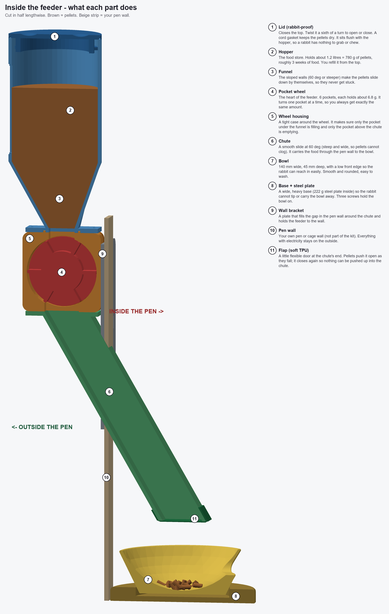
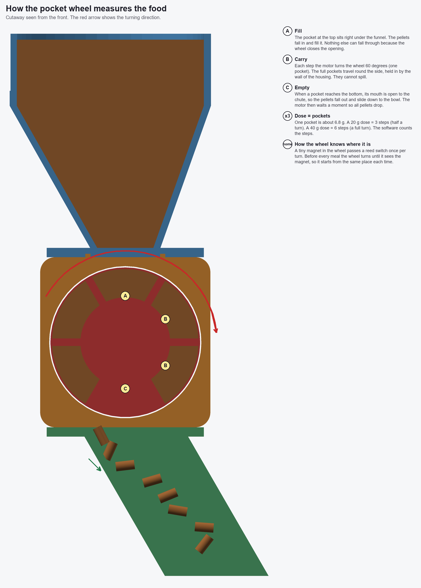
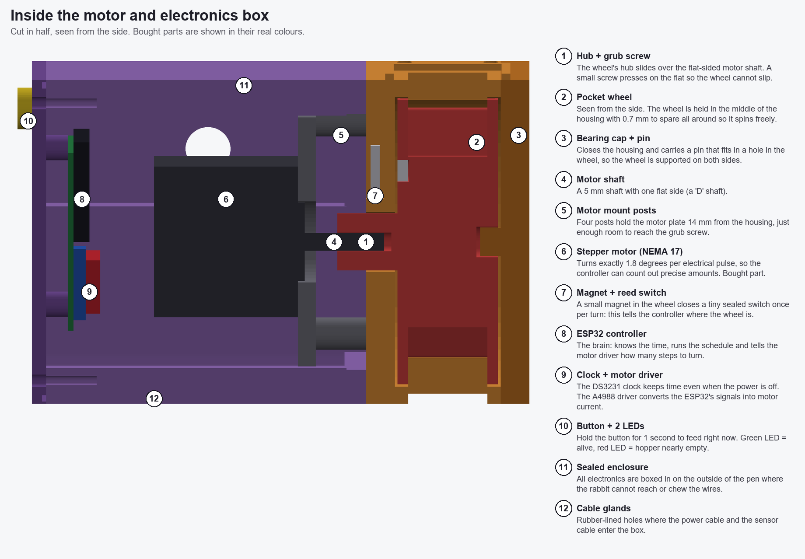
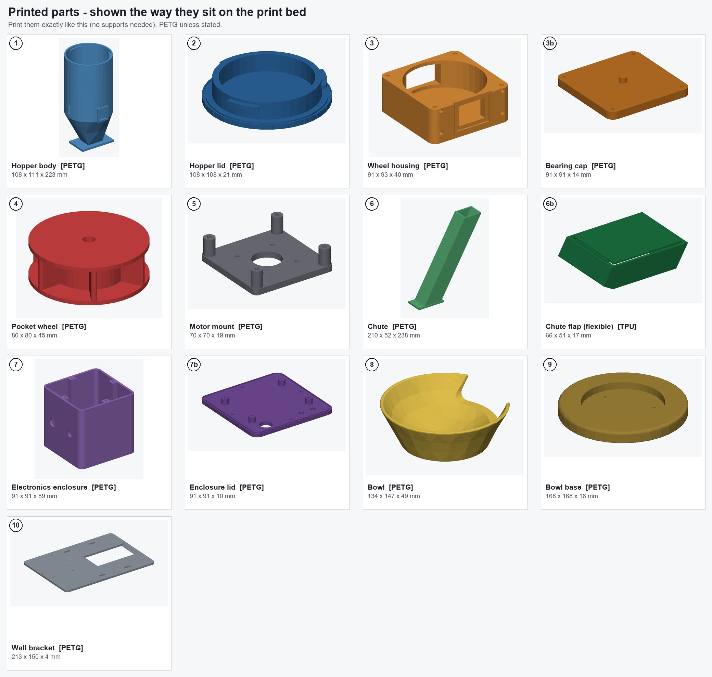
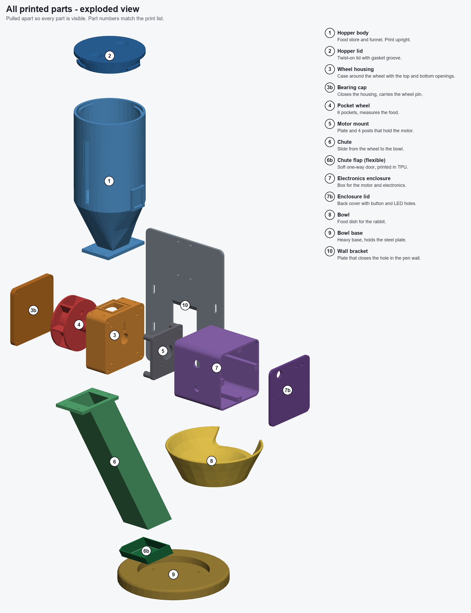
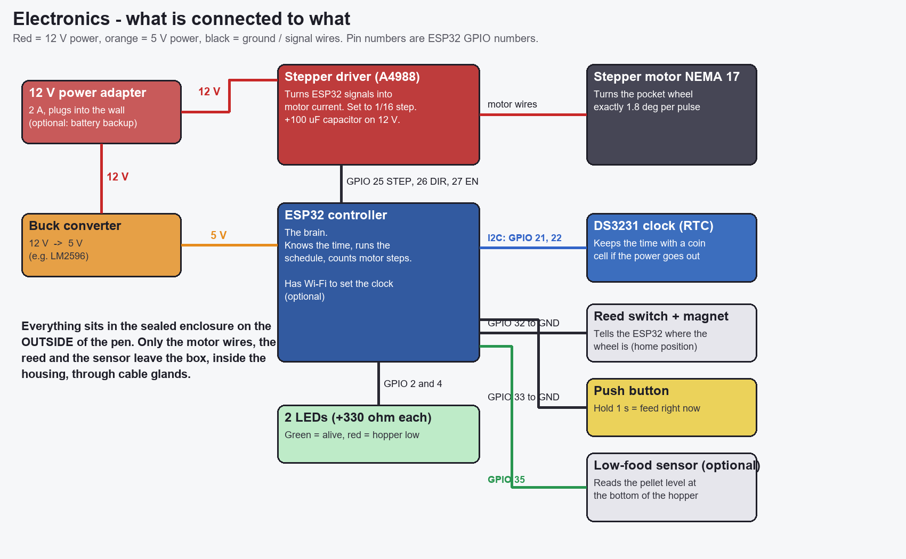

# Automatic rabbit feeder

A feeder you can 3D print and build yourself. Twice a day (by default 07:00 and 19:00) it drops a measured portion of
rabbit pellets (about 20 g, adjustable from 10 to 40 g) into a rabbit-sized bowl. You refill it from the top about once every
3 weeks. The motor and electronics stay outside the pen; only a chute, a bowl and a heavy base are inside.

> **Status:** the design was checked on the computer (sizes, fit, volumes, overlaps, watertight print files - see
> [docs/checks.md](docs/checks.md)). It has **not been printed, built or tested with a real rabbit yet**. Treat it as a
> well-checked first version, and supervise the first days.

**Contents:** [1. How it works](#1-how-it-works) - [2. What each part does](#2-what-each-part-does) -
[3. Everything you need to buy and print](#3-everything-you-need-to-buy-and-print) -
[4. The printed parts](#4-the-printed-parts) - [5. The electronics](#5-the-electronics) -
[6. Build it step by step](#6-build-it-step-by-step) - [7. First start, daily use, calibration](#7-first-start-daily-use-calibration) -
[8. Rabbit safety](#8-rabbit-safety) - [9. Troubleshooting](#9-troubleshooting) - [10. For people who want to change the design](#10-for-people-who-want-to-change-the-design)

---

## 1. How it works

**In one sentence:** pellets fall from a storage tank into a small wheel with 6 pockets; a motor turns the wheel one pocket at a
time, every pocket tips out about 6.8 g of pellets, and they slide down a chute into the bowl.

The story of one feeding:

1. **Storage.** Pellets sit in the hopper (the tank on top, 1.2 litres, about 780 g). The funnel shape makes them slide down by themselves.
2. **Measuring.** At the bottom of the funnel is a wheel with 6 pockets, like a revolving door. The pocket at the top fills with pellets.
   The wheel's housing closes all the other openings, so food can only leave one pocket at a time.
3. **Wake up.** A small computer (an ESP32) and a clock chip know the time. At 07:00 and 19:00 it starts a feeding.
4. **Find the start.** A tiny magnet in the wheel passes a small switch once per turn. The wheel turns until the switch clicks, so it always starts at the same place.
5. **Dose.** A stepper motor turns the wheel exactly 60 degrees per step. Each step brings the next full pocket to the bottom, where it tips out into the chute.
   **A 20 g dose = 3 steps.** The computer counts the steps, so every meal is the same size.
6. **Delivery.** The pellets slide down a smooth chute, through a hole in the pen wall, and drop 8 cm into the bowl.
7. **Safe by design.** The motor, wires and electronics are in a closed box on the **outside** of the pen. The rabbit can only touch the bowl, its base and the end of the chute.
   A flexible flap on the end of the chute stops anything from being pushed back up.

### Picture: inside the feeder

The feeder is cut in half so you can see the inside. The numbers are explained on the right (and again in section 2).

### Picture: how the wheel measures the food

### Picture: the motor and electronics side

---

## 2. What each part does

| # | Part | What it does in plain words | Where |
|---|------|-----------------------------|-------|
| 1 | Hopper body | The tank that stores the pellets; its funnel guides them to the wheel. | outside the pen |
| 2 | Hopper lid | Closes the tank; a sixth of a turn opens it. Keeps the food dry and the rabbit out. | outside |
| 3 | Wheel housing | A tight case around the wheel; it has an opening at the top (pellets in) and one at the bottom (pellets out). | outside |
| 3b | Bearing cap | The cover on the housing; has a pin that holds the wheel in place from the other side. | outside |
| 4 | Pocket wheel | The measuring part: 6 pockets of about 10.5 ml (6.8 g) each. | outside |
| 5 | Motor mount | A plate with 4 posts that holds the motor in the right place, with room to reach the wheel's screw. | outside |
| 6 | Chute | The slide from the wheel to the bowl, 60 degrees steep and 40 x 40 mm wide inside so pellets cannot clog. | passes through the wall |
| 6b | Chute flap (soft TPU) | A flexible door on the chute's end; pellets push it open, then it closes again. | inside |
| 7 | Electronics enclosure | The box around the motor and electronics. | outside |
| 7b | Enclosure lid | The back cover with holes for the button and 2 lights. | outside |
| 8 | Bowl | A smooth 140 mm wide dish, 45 mm deep, with a low front so the rabbit can reach in. | inside |
| 9 | Bowl base | A wide, heavy foot for the bowl. A steel plate inside makes it too heavy to tip over. | inside |
| 10 | Wall bracket | A plate that fills the hole in the pen wall around the chute and holds the feeder to the wall. | outside / in the wall |

Bought parts that matter most: the **stepper motor** (turns the wheel), the **ESP32** (the brain), the **DS3231 clock** (remembers the time during a power cut),
the **A4988 driver** (gives the motor its power), and the **reed switch + magnet** (tell the brain where the wheel is). More in section 5.

---

## 3. Everything you need to buy and print

**Skills:** you need to be able to 3D print in PETG, solder a few wires, and upload a program to a small board (Arduino IDE). No CAD skills.

**Tools:** 3D printer (at least 220 x 220 x 250 mm print volume), soldering iron, small screwdrivers, hex keys, wire cutters, a drill with a 4.5 mm bit (for the steel plate),
a kitchen scale (accurate to 1 g), a computer with a USB cable. The soldering iron also presses in the threaded inserts.

**Shopping list in short:**

| Group | What | Section |
|-------|------|---------|
| Print | 13 parts (about 1 to 1.3 kg of PETG plus a little TPU - this is an estimate) | [4](#4-the-printed-parts) |
| Electronics | motor, ESP32, clock, driver, power, switch, button, LEDs, ... | [5](#5-the-electronics) |
| Hardware | screws, threaded inserts, a steel plate, cord for the gaskets | [5](#hardware-small-parts) |

---

## 4. The printed parts

All files are in the `stl/` folder and are **already turned the right way up** for printing; just load them in your slicer and do not rotate them.
PETG is recommended for everything (strong, does not soften easily, many brands are food-safe; check yours). Use **TPU** for part 6b only.

**Print list**

| # | File (in `stl/`) | How many | Material | Size (mm) on the bed | Notes |
|---|------------------|----------|----------|----------------------|-------|
| 1 | 01_hopper_body.stl | 1 | PETG | 108 x 111 x 223 | 3-4 walls |
| 2 | 02_hopper_lid.stl | 1 | PETG | 108 x 108 x 21 | |
| 3 | 03_wheel_housing.stl | 1 | PETG | 91 x 93 x 40 | 4 walls |
| 3b | 03b_bearing_cap.stl | 1 | PETG | 91 x 91 x 14 | |
| 4 | 04_pocket_wheel.stl | 1 | PETG | 80 x 80 x 45 | 4 walls; the roofs of the pockets bridge about 36 mm, enable supports **inside the pockets only** if your printer sags |
| 5 | 05_motor_mount.stl | 1 | PETG | 70 x 70 x 19 | |
| 6 | 06_chute.stl | 1 | PETG | 210 x 52 x 238 | **100 % walls**, 4+ perimeters; it leans on purpose; needs a bed of at least 215 mm wide and 240 mm tall |
| 6b | 06b_chute_flap_TPU.stl | 1 | **TPU 95A** | 66 x 51 x 17 | slow, direct drive recommended |
| 7 | 07_enclosure.stl | 1 | PETG | 91 x 91 x 89 | |
| 7b | 07b_enclosure_lid.stl | 1 | PETG | 91 x 91 x 10 | |
| 8 | 08_bowl.stl | 1 | PETG (food-safe) | 134 x 147 x 49 | **100 % walls**, smooth, no supports |
| 9 | 09_bowl_base.stl | 1 | PETG | 168 x 168 x 16 | |
| 10 | 10_wall_bracket.stl | 1 | PETG | 213 x 150 x 4 | only needed for the wall interface |

General slicer settings: 0.2 mm layers, **no supports**, 4 or more perimeters (walls), 30 % infill (100 % perimeters on chute and bowl). The files are watertight, so no repair is needed.

The **exploded view** below shows how everything fits together (numbers match the table).

---

## 5. The electronics

Everything electrical sits inside part 7 (the enclosure), on the outside of the pen. This is the complete list:

| Qty | Part | What it does in plain words |
|-----|------|-----------------------------|
| 1 | **NEMA 17 stepper motor**, 40 mm body, 5 mm shaft with one flat side ("D shaft"), at least 0.4 Nm | Turns the wheel in exact steps of 1.8 degrees. |
| 1 | **A4988 or DRV8825 stepper driver** with a 100 uF capacitor | Gives the motor its power; the ESP32 only sends it "step" and "direction" signals. |
| 1 | **ESP32 DevKit** (30-pin version) | The brain. Runs the schedule and counts the steps. Has Wi-Fi to set the clock. |
| 1 | **DS3231 clock module** + CR2032 battery | Knows the time even when the power is out, so you never miss a meal. |
| 1 | **12 V, 2 A power supply** with a plug for the box | Powers everything. |
| 1 | **Buck converter 12 V to 5 V** (for example LM2596) | Makes the 5 V the ESP32 needs from the 12 V. |
| 1 | **Reed switch** (small glass switch, 2.7 x 14 mm) | Closes when the magnet passes: "the wheel is at home". |
| 1 | **Magnet**, disc 6 x 3 mm | Glued in the wheel. |
| 1 | **Push button**, 12 mm panel mount | Hold 1 second to feed right now. |
| 2 | **LEDs**, 5 mm (green, red) + two 330 ohm resistors | Green = alive, red = hopper nearly empty. |
| 1 | **Perfboard** 70 x 50 mm and pin headers | A small board the modules are plugged or soldered on. |
| 1 | **Level sensor** (optional), 3.3 V logic, for example a capacitive sensor | Tells the ESP32 the hopper is nearly empty. |
| 2 | **Cable glands** PG7 (hole 6.3 mm) | Where the cables enter the box. |
| 1 | Battery backup (optional): 3 x AA holder or 18650 + diode | Keeps the feeder running during a power cut. |
| - | Hookup wire, heat shrink | |

### Wiring diagram

| Signal | ESP32 pin | Goes to |
|--------|-----------|---------|
| STEP / DIR / ENABLE | GPIO 25 / 26 / 27 | A4988 STEP / DIR / ENABLE |
| Microstep pins MS1, MS2, MS3 | 3.3 V | A4988 (this sets 1/16 steps) |
| Wheel home switch (reed) | GPIO 32 and GND | reed switch |
| Feed-now button | GPIO 33 and GND | button |
| Green LED | GPIO 2 | LED + 330 ohm to GND |
| Red LED | GPIO 4 | LED + 330 ohm to GND |
| Low-food sensor | GPIO 35 | sensor output (HIGH = low) |
| Clock SDA / SCL | GPIO 21 / 22 | DS3231 |
| Motor power | 12 V | A4988 VMOT and GND, with the 100 uF capacitor close by |
| Brain power | 5 V from the buck converter | ESP32 VIN |

Set the driver's current limit to about 0.8 A (turn the small screw on the driver; the right voltage depends on the driver model, so follow its guide).
Double-check the order of the motor wires with the driver's datasheet before powering it up.

### Hardware (small parts)

| Qty | Part | Used for |
|-----|------|----------|
| 24 | M3 heat-set threaded inserts (5.7 mm long) | housing (top, bottom, cap, box, posts, bracket: 4 each) |
| 3 | M4 heat-set threaded inserts | bowl foot |
| 8 | M3 x 12 screws | hopper and chute to the housing |
| 4 | M3 x 12 screws | bearing cap |
| 4 | M3 x 20 screws | motor mount posts |
| 4 | M3 x 8 screws | motor to the plate |
| 4 | M3 x 16 screws (hex, long reach) | enclosure to the housing |
| 4 | M3 x 10 self-tapping screws | enclosure lid |
| 4 | M3 x 12 screws | bracket to the housing |
| 1 | M3 x 6 grub screw (or M3 x 8 screw) | holds the wheel on the shaft |
| 3 | M4 x 16 countersunk screws | bowl + weight plate + base |
| 1 | **Steel plate 106 mm round, 3.2 mm thick (about 222 g)** | weight in the bowl base |
| 2 m | 2 mm silicone cord or foam strip | gaskets for the lid and the box |
| 1 | Clear PETG or acrylic strip 1 x 14 x 94 mm | the fill-level window |
| - | Super glue or epoxy | magnet, reed switch, window |

---

## 6. Build it step by step

Take your time; each step is small.

1. **Print everything** from section 4. Check that the wheel (4) turns easily in the housing (3) when you hold them together before you glue anything.
2. **Add threaded inserts.** Press them in with a hot soldering iron (the holes are already there): M3 into the 4 holes in the top and 4 in the bottom of the housing (3), 4 on each side of the housing for the cap and the box, 4 for the posts, 4 on the side facing the pen for the bracket.
   Put 3 M4 inserts into the bowl's foot (the 3 holes at the bottom of the bowl).
3. **Magnet.** Glue the 6 x 3 mm magnet into the round hole in the flat face of the wheel (the face with the long hub). Glue the reed switch into the slot on the outside of the housing wall
   behind the magnet's position (same height as the magnet, 20 mm from the middle).
4. **Wheel in the housing.** Push the wheel's hub through the round hole in the housing's thick wall. Put the bearing cap (3b) on the other side, so its pin goes into the wheel's round hole. Fasten with 4 x M3 x 12. The wheel must turn freely.
5. **Motor.** Screw the NEMA 17 to the motor mount (5) with 4 x M3 x 8. Slide the shaft into the hub's flat-sided hole and fasten the mount to the housing with 4 x M3 x 20. Tighten the small grub screw on the flat part of the shaft through the gap between the plate and the housing.
6. **Electronics.** Build the circuit on the perfboard following the wiring diagram. Screw the board onto the 4 posts of the enclosure lid (7b). Fit the button and the 2 LEDs in their holes in the lid. Push the cables through the glands.
7. **Close the electronics box.** Screw the enclosure (7) to the housing with 4 long M3 screws, put the gasket cord in the groove on the lid, and close it with 4 self-tapping screws.
8. **Hopper.** Press a 2 mm cord into the groove in the lid (2). Screw the hopper (1) onto the top of the housing: the raised frame on the housing fits the groove under the hopper's flange. Glue the clear strip over the window slot.
9. **Chute and bracket.** Screw the chute (6) to the bottom of the housing. Slide the bracket (10) up over the free end of the chute, then screw it to the housing. Pull the soft flap (6b) over the lower end of the chute.
10. **Bowl.** Drill three 4.5 mm holes in the steel plate (on a circle of 80 mm diameter, 120 degrees apart; no countersinking needed, the screw heads sit in the base). Lay the plate in the round recess of the base (9), place the bowl (8) on top and screw it on from below with 3 x M4 x 16.
11. **Mount on the pen.** Make an opening in the pen wall of about **49 mm wide and 96 mm high**, tilted like the chute is (the bracket plate covers the opening). Hang the feeder with cable ties through the slots of the bracket. The bowl base must stand about 2 mm from the wall,
    so the end of the chute is exactly above the bowl, 8 cm up.
12. **Firmware.** Install the Arduino IDE, add ESP32 board support and the library "RTClib" (Adafruit). Open `firmware/rabbit_feeder/rabbit_feeder.ino`, fill in your Wi-Fi name and password (optional), check the feeding times and doses,
    and upload it. The firmware has not been tested on hardware yet, so test it with the wheel removed or the hopper empty first.

---

## 7. First start, daily use, calibration

**First start**

1. Put a handful of pellets in the hopper and close the lid (twist it a sixth of a turn).
2. Do **two test feedings**: hold the feed-now button for 1 second, wait until the wheel stops, and do it again. This fills all 6 pockets. Throw the pellets away (or give them as a treat); the very first dose would be too small otherwise.
3. The green light blinks twice after switching on; it blips every 10 seconds while it waits.

**Every day:** nothing. It feeds by itself. **About every 3 weeks:** the red light comes on (if you have the level sensor) or you look through the window; open the lid and add pellets.
Fill up to about 2.5 cm below the rim; the lid's plug needs that space.

**Feed now:** hold the button for 1 second.

**Calibrate** (do this once, and again when you change the brand of pellets):

1. Hold a cup under the end of the chute.
2. Feed 10 times and weigh each portion (kitchen scale).
3. Take the average. For example, 18.4 g when you want 20 g.
4. In the sketch, change `DOSE_MULTIPLIER` to `20 / 18.4 = 1.087` and upload again.
5. Repeat until the average is within 1 g.

If it is more than 6.8 g (one pocket) off, change the number of pockets instead: the dose in grams in the sketch decides how many pockets are used.

---

## 8. Rabbit safety

* All electronics, wires and the motor are **outside the pen**. Keep the power cable out of reach.
* Inside the pen the rabbit can only reach the bowl, the base and the end of the chute. They have 4 mm walls, rounded edges, no gaps between 6 and 25 mm where a toe or head could get stuck, and no loose small parts.
* Rabbits chew everything. **Watch it for the first days.** If you see bite marks in the plastic, remove the part and replace it. Do not use PLA inside the pen.
* The bowl and base should be washed with warm water and soap every few days. The bowl's inside is smooth and rounded.
* Always check how much your rabbit should eat with your vet; the default of 2 x 20 g is just an example.

---

## 9. Troubleshooting

| Problem | Likely cause | What to do |
|---------|--------------|------------|
| Nothing happens at feeding time | The clock is wrong or the power is off | Check the time in the serial monitor (115200 baud); connect Wi-Fi once to set the clock |
| Motor buzzes but does not turn | Wires swapped or current too low | Check the motor wire pairs; turn the driver's current screw slightly up |
| Wheel stalls or the pellets get stuck | A crumb wedged between the wheel and the housing | The program reverses 30 degrees and tries again. If it keeps happening, clean the wheel and check that the wheel turns by hand |
| The green light flashes 10 times | The feeding failed 3 times (jam) | Look inside, remove the blockage, then hold the button to test |
| Dose too small or too large | New brand of pellets (different weight) | Calibrate again (section 7) |
| First dose is too small | Some pockets were empty | Do two test feedings after filling (section 7) |
| Pellets stay in the chute | The chute is not steep or has crumbs | Check that the angle is 60 degrees and the chute is clean and smooth |

---

## 10. For people who want to change the design

Everything is generated from one program, so you can change sizes (for example a bigger bowl for a giant rabbit) without drawing anything.

| File | What |
|------|------|
| [feeder.py](feeder.py) | all dimensions as named variables at the top (bowl_diameter, bowl_depth, rim_height, wheel_od, chute_angle, hopper_volume_ml, ...) and one function per part |
| [build.py](build.py) | writes the STL files (`stl/`), STEP files (`step/`), the report [docs/checks.md](docs/checks.md) and [docs/assembly.png](docs/assembly.png) |
| [render_docs.py](render_docs.py) | makes the pictures in this README |
| [to_freecad.py](to_freecad.py) | puts all parts in the FreeCAD file `baya feeder.FCStd` (`freecadcmd to_freecad.py`; delete the old parts in the FreeCAD file first) |
| [firmware/](firmware/rabbit_feeder/rabbit_feeder.ino) | the ESP32 program |
| [BOM.md](BOM.md) | bill of materials |

To rebuild: `pip install cadquery pillow numpy trimesh`, then `python build.py` and `python render_docs.py` (about a minute).

### Key numbers (from `docs/checks.md`)

| | |
|---|---|
| Pocket volume | 10.5 ml = 6.8 g at 0.65 g/ml, 6 pockets, opening 36 mm (7 x the 5 mm pellet) |
| Dose | 20 g = 3 pockets (half a turn); 10 g = 1-2 pockets, 40 g = 6 pockets |
| Hopper | 1200 ml usable = 780 g = **19.5 days at 40 g/day** (39 days at 20 g/day), 100 mm opening, funnel walls 60 degrees or steeper |
| Chute | 60 degrees above horizontal, 40 x 40 mm inside |
| Bowl | 140 mm wide, 45 mm deep, 394 ml, front edge 32 mm high; base 168 mm wide (1.2 x) with a 222 g steel plate |
| Drop height | 80 mm from the end of the chute to the floor of the bowl |
| Height | about 650 mm in total; the largest part to print is the chute: 210 x 52 x 238 mm |

### Assumptions I made (where the design brief was ambiguous)

* **Chute slope.** "60 degrees or steeper from vertical" can be read two ways. I used 60 degrees above horizontal, which satisfies both. It makes the chute long (238 mm drop), because the bowl has to stand clear of the wall.
* **Pockets.** The pockets are wedge-shaped with a 4 mm web, because a 20 x 20 x 25 mm box pocket does not fit 6 times on an 80 mm wheel.
* **Drive.** The wheel sits directly on the NEMA 17 shaft with a grub screw, so there is no separate coupler. A 28BYJ-48 motor would need a different hub.
* **Pen wall.** The pen wall is assumed to be 5 mm thick, with the bowl base 2 mm from it (`cage_wall_t`, `base_gap`).
* **Wall thickness.** The wall values in the report are design values, not an analysis of the sliced model.
* **Not built yet.** Nothing was printed, wired or tested with real pellets, and the firmware has not run on real hardware.
